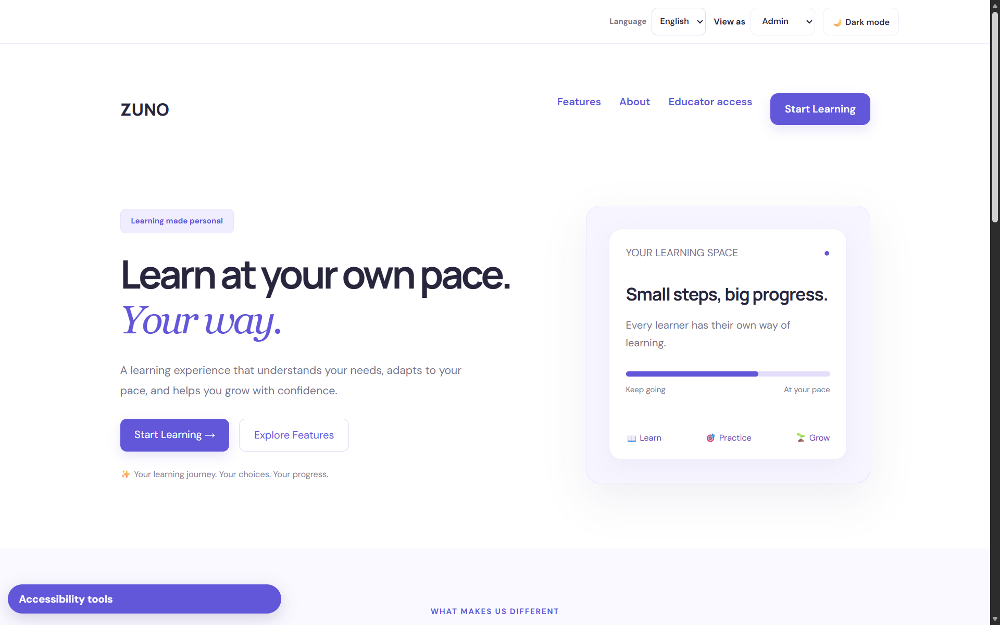
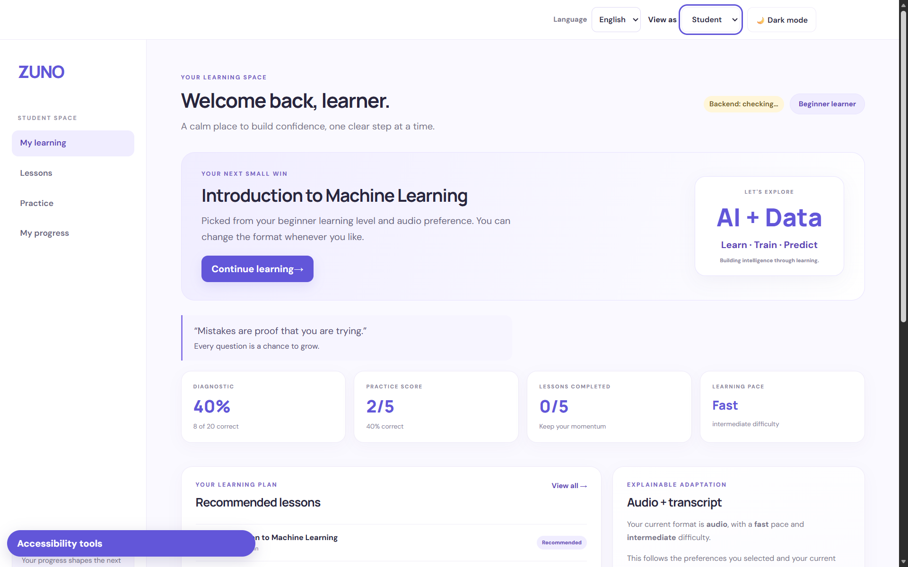
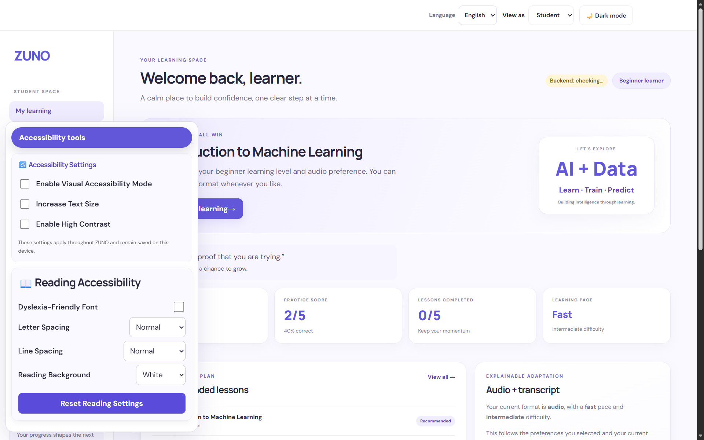
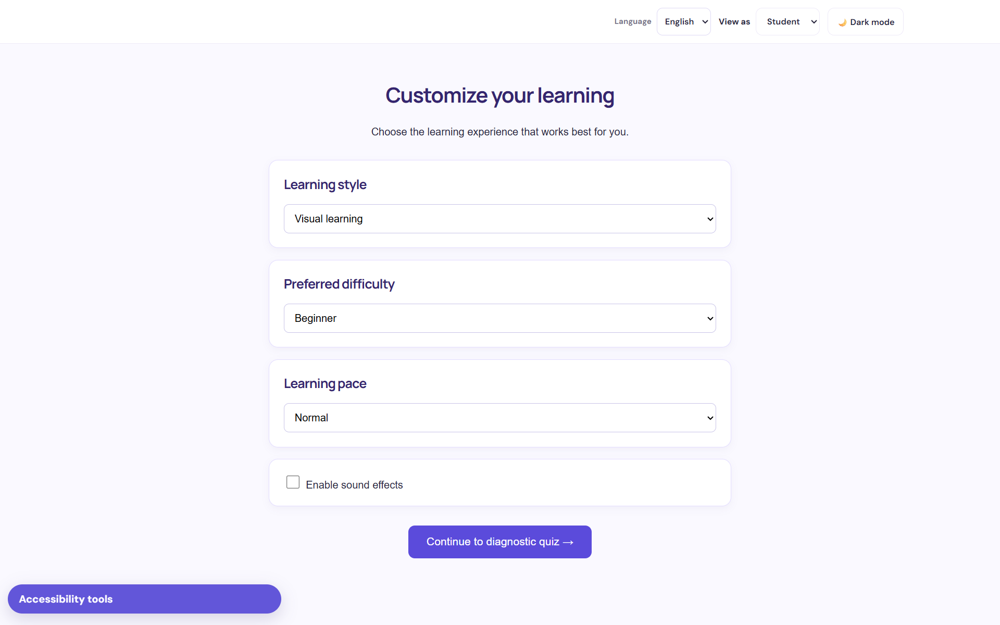
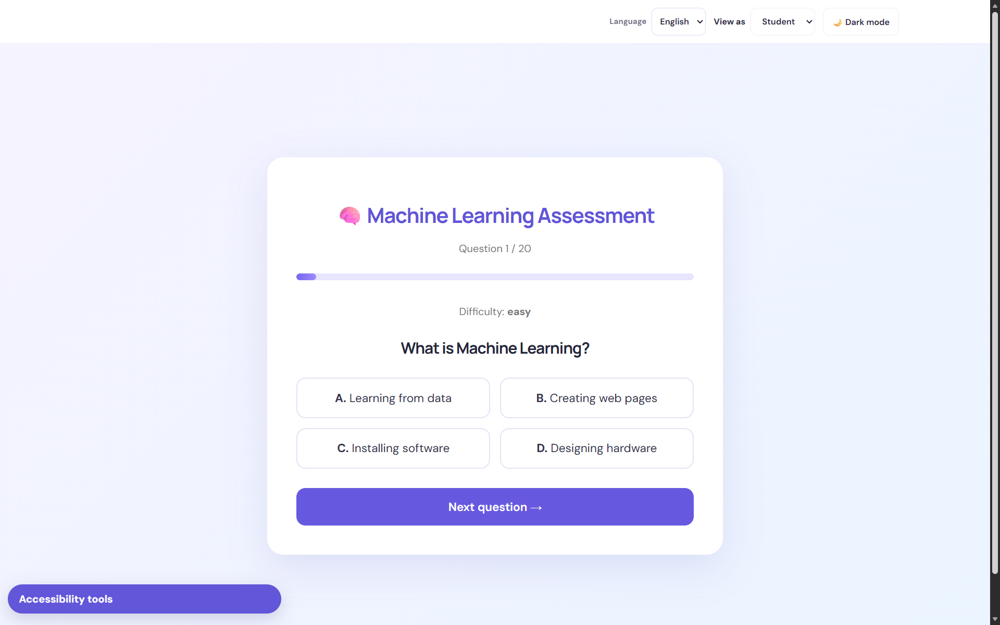
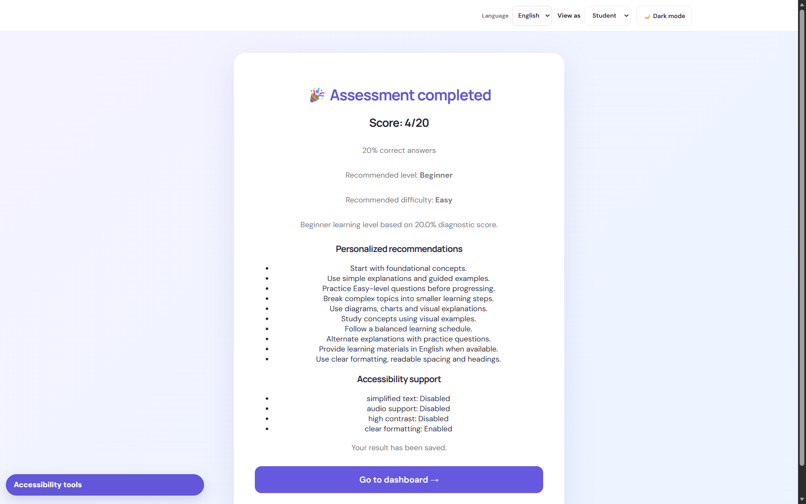
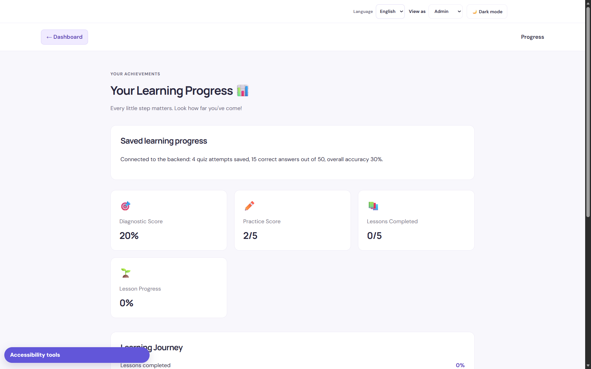
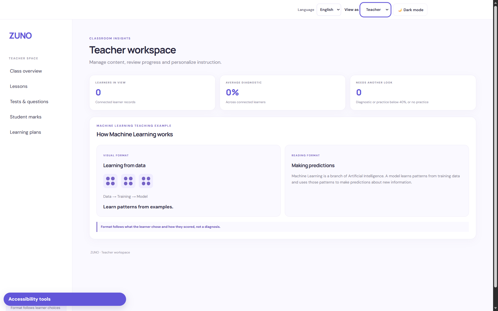
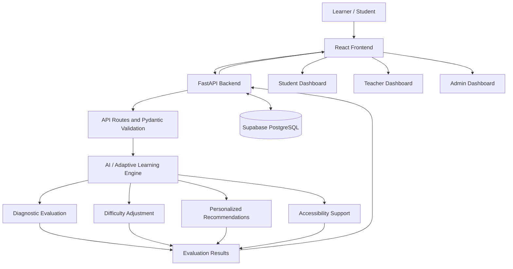

# ZUNO – Inclusive Adaptive Learning Platform

<p align="center">
  <strong>NeuralStorm | Team BrainByte | Neural Storm Hackathon 2026</strong>
</p>

<p align="center">
  <em>Learning at your own pace, in your own way.</em>
</p>

<p align="center">
  <a href="https://neural-storm-zuno.vercel.app/">Live Website</a> •
  <a href="https://zuno-backend-ahir.onrender.com/docs">API Documentation</a> •
  <a href="https://github.com/sai-dharahas07/NeuralStorm-ZUNO">GitHub Repository</a>
</p>

---

## 1. About the Project

**ZUNO** is an inclusive, AI-powered adaptive learning platform designed to make education accessible, personalized, and engaging for everyone, especially learners with disabilities and different learning needs.

Traditional learning platforms often follow a one-size-fits-all approach. However, every learner has different abilities, learning speeds, preferences, and challenges.

Students with visual, hearing, cognitive, and other learning difficulties may face additional barriers when using conventional educational platforms.

ZUNO addresses these challenges by combining diagnostic assessments, adaptive difficulty adjustment, accessibility support, and personalized learning recommendations.

Our goal is simple:

**To make learning accessible to everyone, regardless of their abilities or learning pace.**

### Project Information

| Category | Details |
|---|---|
| Project Name | ZUNO |
| Team Name | NeuralStorm / BrainByte |
| Hackathon | Neural Storm Hackathon 2026 |
| Problem Statement | HI-03 |
| Problem Statement Title | Adaptive Learning for Students with Disabilities |
| Application Type | Inclusive Adaptive Learning Platform |
| Frontend Deployment | Vercel |
| Backend Deployment | Render |
| Database | Supabase PostgreSQL |

## 2. Problem Statement

Many existing digital learning platforms do not adequately accommodate learners with disabilities or different learning requirements.

Some common challenges include:

- Learning materials that are difficult to understand.
- Limited accessibility and personalization options.
- Fixed learning difficulty levels.
- Lack of individual learning recommendations.
- Difficulty identifying a student's strengths and weaknesses.
- Learning experiences that do not adapt to individual student progress.

ZUNO aims to address these challenges through accessibility-oriented features, diagnostic assessments, adaptive difficulty, and personalized learning recommendations.

## 3. Our Solution

ZUNO provides an inclusive learning environment where educational support can adapt to individual student requirements.

### Key Features

**1. Adaptive Learning Engine**
- Evaluates student performance through diagnostic assessments.
- Identifies the learner's current learning level.
- Recommends suitable difficulty levels.
- Adjusts practice difficulty based on recent performance.
- Provides personalized learning recommendations.

**2. Accessibility Support**
- Simplified text support.
- Audio support configuration.
- High-contrast display options.
- Clear formatting for improved readability.
- Accessibility preferences based on individual learner needs.

**3. Diagnostic Assessment**
- Provides educational questions from a structured question bank.
- Evaluates student answers.
- Identifies correct, incorrect, and unanswered questions.
- Calculates assessment scores and accuracy.
- Determines the learner's current understanding.

**4. Personalized Recommendations**
- Recommends learning activities based on assessment results.
- Provides explanations suited to the learner's level.
- Suggests appropriate practice activities.
- Supports individualized learning journeys.

**5. Student Dashboard**
- Provides access to learning activities.
- Displays learning progress and assessment results.
- Helps students understand their learning journey.

**6. Teacher Dashboard**
- Supports educational content and lesson management.
- Provides functionality for creating and managing learning tests.
- Helps teachers support student learning activities.

**7. Admin Dashboard**
- Provides administrative management functionality.
- Supports teacher and learning-content management.

## 4. Application Screenshots

The following screenshots illustrate the major interfaces and learning experiences offered by ZUNO.

> **Screenshot setup:** Save your actual application screenshots inside `docs/screenshots/` using the filenames below. Replace the placeholder images with genuine screenshots before publishing the README. The uploaded project ZIP did not contain these eight application screenshots.

### 4.1 Landing Page



*Introduction to ZUNO and its inclusive learning experience.*

### 4.2 Learner Dashboard



*The learner's main dashboard for accessing learning activities.*

### 4.3 Accessibility Preferences



*Personalized accessibility settings for different learner requirements.*

### 4.4 Learning Preferences



*Selection of learning style, difficulty, pace, and language preferences.*

### 4.5 Diagnostic Assessment



*Assessment interface used to understand the learner's current knowledge.*

### 4.6 Adaptive Learning



*Adaptive difficulty recommendations based on student performance.*

### 4.7 Progress Tracking



*Student assessment history and learning progress.*

### 4.8 Teacher and Admin Dashboards



*Management interfaces supporting teachers and administrators.*

## 5. How ZUNO Works – Project Workflow

ZUNO follows a learner-centered workflow.

1. **Learner Access:** The student enters the ZUNO learning platform.
2. **Accessibility Preferences:** The learner selects suitable accessibility preferences.
3. **Learning Preferences:** The student chooses preferred learning format, pace, and language.
4. **Diagnostic Assessment:** The learner answers educational assessment questions.
5. **AI Evaluation:** The backend processes the learner's answers and evaluates performance.
6. **Learning-Level Identification:** The system identifies the learner's current learning level.
7. **Adaptive Difficulty:** The platform determines the recommended difficulty.
8. **Personalized Recommendations:** Learning recommendations are generated based on the assessment and preferences.
9. **Accessibility Adaptation:** Accessibility settings are prepared according to the learner's requirements.
10. **Continuous Learning:** Students continue learning through lessons and practice activities.

## 6. System Architecture

ZUNO uses a modular architecture that separates the user interface, backend services, adaptive learning logic, and database.

### 6.1 Architecture Diagram



### 6.2 Architecture Explanation

| Component | Responsibility |
|---|---|
| React Frontend | Provides the user interface and learning experience. |
| API Communication | Connects the frontend with backend services. |
| FastAPI Backend | Handles requests, validation, processing, and responses. |
| Diagnostic Module | Evaluates student answers and calculates assessment results. |
| Adaptive Module | Determines learning levels and adjusts difficulty. |
| Recommendation Module | Generates learning suggestions based on student performance and preferences. |
| Accessibility Module | Generates accessibility settings based on learner requirements. |
| PostgreSQL Database | Stores quiz attempts and AI evaluation records. |

### 6.3 Data Flow

1. The student interacts with the frontend.
2. The frontend sends the required information to the backend.
3. FastAPI validates the incoming request.
4. The AI engine processes the assessment and learner preferences.
5. The diagnostic module calculates the score.
6. The adaptive module identifies the appropriate difficulty.
7. The recommendation and accessibility modules generate relevant outputs.
8. The backend validates and returns the results.
9. Evaluation and quiz information can be stored in PostgreSQL.
10. The frontend displays the resulting learning information.

## 7. Adaptive Learning Logic

One of the most important components of ZUNO is its adaptive learning engine.

Instead of assigning the same difficulty to every student, ZUNO uses assessment performance to identify an appropriate starting level.

### 7.1 Diagnostic Learning-Level Classification

The diagnostic module calculates the learner's score using:

\[
\text{Score Percentage} =
\frac{\text{Correct Answers}}{\text{Total Questions}}
\times 100
\]

The current implemented learning-level thresholds are:

| Score Percentage | Learning Level | Recommended Difficulty |
|---|---|---|
| 0%–40% | Beginner | Easy |
| Above 40%–70% | Intermediate | Medium |
| Above 70%–100% | Advanced | Hard |

The classification is implemented in:

- `backend/ai_engine/diagnostic.py`
- `backend/ai_engine/difficulty.py`
- `backend/ai_engine/adaptive.py`

### 7.2 Continuous Difficulty Adaptation

ZUNO also includes a practice-based adaptation mechanism.

It evaluates recent practice answers and determines whether difficulty should increase, decrease, or remain unchanged.

The implemented rules are:

| Recent Practice Accuracy | Adaptation |
|---|---|
| 80% or above | Increase difficulty by one level |
| 40% or below | Decrease difficulty by one level |
| Between 40% and 80% | Maintain current difficulty |
| Fewer than 5 answers | Maintain current difficulty until sufficient answers are available |

Difficulty progression:

```text
Easy → Medium → Hard
```

The engine does not increase difficulty beyond Hard or decrease it below Easy.

### 7.3 Worked Example

Consider a student named Alex who takes a diagnostic assessment containing five questions.

**Step 1: Diagnostic Assessment**

| Question | Student Answer | Result |
|---|---|---|
| Q1 | Correct | Correct |
| Q2 | Correct | Correct |
| Q3 | Incorrect | Incorrect |
| Q4 | Correct | Correct |
| Q5 | Correct | Correct |

**Step 2: Calculate Performance**

- Total Questions: 5
- Correct Answers: 4
- Incorrect Answers: 1
- Unanswered Questions: 0

\[
\text{Score} = \frac{4}{5}\times100=80\%
\]

**Step 3: Identify Learning Level**

Since 80% is above 70%:

- Learning Level: Advanced
- Recommended Difficulty: Hard

**Step 4: Generate Recommendations**

The recommendation module selects learning support appropriate for the Advanced level.

For example:

- Advanced explanations.
- Challenging practice questions.
- Advanced concepts.
- Exploration of advanced topics and projects.

**Step 5: Accessibility Adaptation**

If the student has selected accessibility preferences, the accessibility module generates the corresponding settings, including simplified text, audio support, high contrast, and clear formatting.

**Final Result**

| Output | Result |
|---|---|
| Assessment Score | 80% |
| Learning Level | Advanced |
| Recommended Difficulty | Hard |
| Practice Recommendation | Challenging Questions |
| Next Learning Action | Explore Advanced Topics |

This example demonstrates how ZUNO converts assessment results into an individualized learning recommendation.

### 7.4 Accessibility Logic

The accessibility module supports the following response fields:

| Field | Purpose |
|---|---|
| `simplified_text` | Supports easier-to-understand content. |
| `audio_support` | Represents audio accessibility support. |
| `high_contrast` | Supports improved visual contrast. |
| `clear_formatting` | Enables clear content presentation. |

The system also considers selected accessibility requirements when preparing these settings.

For example:

- Dyslexia or learning disability can enable simplified text.
- Blindness or visual impairment can enable audio support.
- Visual impairment or low vision can enable high contrast.
- Clear formatting is enabled by default.

## 8. Technology Stack

| Component | Technologies |
|---|---|
| Frontend | React.js |
| Build Tool | Vite |
| Styling | CSS |
| Backend | Python, FastAPI |
| AI / Adaptive Engine | Python |
| API Validation | Pydantic |
| Database | Supabase PostgreSQL |
| Database Integration | SQLAlchemy |
| Database Driver | Psycopg |
| Frontend Deployment | Vercel |
| Backend Deployment | Render |
| Version Control | Git and GitHub |

### Why We Chose This Technology Stack

- **React.js:** Builds interactive and reusable user interfaces.
- **Vite:** Provides a fast frontend development and production build process.
- **Python:** Supports adaptive learning and educational evaluation logic.
- **FastAPI:** Provides efficient backend API development.
- **Pydantic:** Validates incoming requests and structured responses.
- **SQLAlchemy:** Supports database interaction.
- **Supabase PostgreSQL:** Stores structured application data.
- **Vercel:** Hosts the frontend application.
- **Render:** Hosts the backend API.
- **Git and GitHub:** Support version control and team collaboration.

## 9. API Documentation and Endpoints

ZUNO uses REST APIs to connect the frontend with backend services.

### 9.1 Base URLs

**Production Backend:**

```text
https://zuno-backend-ahir.onrender.com
```

**Local Development:**

```text
http://127.0.0.1:8000
```

### 9.2 Implemented API Endpoints

The following endpoints are defined in the backend route files included in the project.

| Method | Endpoint | Purpose |
|---|---|---|
| GET | `/` | Returns backend application information. |
| GET | `/health` | Checks backend availability. |
| GET | `/health/database` | Checks database connectivity. |
| GET | `/api/ai/questions` | Retrieves diagnostic questions without exposing correct answers. |
| POST | `/api/ai/evaluate` | Evaluates student answers and returns adaptive learning results. |
| POST | `/api/v1/quiz/attempts` | Saves a student's quiz attempt. |
| GET | `/api/v1/quiz/attempts/{student_id}` | Retrieves quiz attempts for a student. |
| GET | `/api/v1/students/{student_id}/progress` | Retrieves aggregated student progress. |

### 9.3 Important API Details

**1. Health Check**

```http
GET /health
```

Example response:

```json
{
  "status": "ok",
  "service": "neural-storm-backend",
  "message": "Backend is running"
}
```

**2. Retrieve Diagnostic Questions**

```http
GET /api/ai/questions
```

Returns the Machine Learning question set, without exposing the correct answers.

**3. Evaluate Student Performance**

```http
POST /api/ai/evaluate
```

Example request:

```json
{
  "student_id": "student_001",
  "topic": "Machine Learning",
  "quiz_answers": {
    "ml_001": "A",
    "ml_002": "B"
  },
  "learning_preferences": {
    "preferred_format": "visual",
    "preferred_pace": "normal",
    "language": "English"
  },
  "accessibility": {
    "disability_type": ["dyslexia"],
    "needs_simplified_text": true,
    "needs_audio_support": false,
    "needs_high_contrast": false
  }
}
```

The `quiz_answers` object above is an illustrative request. Actual question IDs should be obtained from the questions endpoint.

The response contains:

- Diagnostic evaluation.
- Correct and incorrect answer counts.
- Score percentage and accuracy.
- Identified learning level.
- Recommended difficulty.
- Personalized recommendations.
- Accessibility support settings.

**4. Save Quiz Attempt**

```http
POST /api/v1/quiz/attempts
```

Stores a student's quiz attempt in the database.

**5. Retrieve Quiz Attempts**

```http
GET /api/v1/quiz/attempts/{student_id}
```

Returns stored quiz attempts for the specified student.

**6. Retrieve Student Progress**

```http
GET /api/v1/students/{student_id}/progress
```

Returns aggregated learning information, including:

- Total quizzes attempted.
- Total questions answered.
- Total correct answers.
- Average score.
- Overall accuracy.
- Latest difficulty level.
- Last attempt timestamp.

### 9.4 Interactive API Documentation

FastAPI provides interactive API documentation.

**Production API Documentation:**

https://zuno-backend-ahir.onrender.com/docs

**Local API Documentation:**

http://127.0.0.1:8000/docs

## 10. Project Structure

The project is organized into separate frontend and backend components, with the adaptive learning engine maintained as a Python package within the backend.

```text
NeuralStorm_ZUNO/
│
├── frontend/
│   ├── public/
│   ├── src/
│   │   ├── assets/
│   │   ├── components/
│   │   ├── data/
│   │   ├── i18n/
│   │   ├── pages/
│   │   ├── services/
│   │   └── utils/
│   │
│   ├── package.json
│   ├── vite.config.js
│   └── vercel.json
│
├── backend/
│   ├── app/
│   │   ├── models/
│   │   ├── routes/
│   │   ├── schemas/
│   │   ├── config.py
│   │   ├── database.py
│   │   └── main.py
│   │
│   ├── ai_engine/
│   │   ├── adaptive.py
│   │   ├── adaptive_engine.py
│   │   ├── diagnostic.py
│   │   ├── difficulty.py
│   │   ├── learning_content.py
│   │   ├── questions.py
│   │   ├── quiz.py
│   │   └── recommendations.py
│   │
│   ├── data/
│   │   └── questions.json
│   │
│   ├── requirements.txt
│   └── ...
│
├── docs/
│   └── screenshots/
│       ├── 01-landing-page.png
│       ├── 02-student-dashboard.png
│       ├── 03-accessibility-preferences.png
│       ├── 04-learning-preferences.png
│       ├── 05-diagnostic-assessment.png
│       ├── 06-adaptive-learning.png
│       ├── 07-progress-tracking.png
│       └── 08-teacher-admin-dashboard.png
│
├── README.md
└── .gitignore
```

### Important AI Engine Path Note

The intended importable AI package location is:

```text
backend/ai_engine/
```

The FastAPI AI route imports:

```python
from ai_engine.pipeline import evaluate_student
```

However, in the supplied project archive, `pipeline.py`, `accessibility.py`, and `recommender.py` are located under:

```text
backend/backend/ai_engine/
```

These files need to be integrated into the canonical `backend/ai_engine/` package, with their imports and dependencies aligned, before the documented AI evaluation integration can be considered complete.

The intended final arrangement is:

```text
backend/
│
├── app/
│   ├── main.py
│   └── routes/
│       └── ai.py
│
├── ai_engine/
│   ├── __init__.py
│   ├── pipeline.py
│   ├── diagnostic.py
│   ├── adaptive.py
│   ├── difficulty.py
│   ├── questions.py
│   ├── recommender.py
│   ├── recommendations.py
│   └── accessibility.py
│
└── data/
    └── questions.json
```

This structure ensures that the application imports the AI modules from one consistent package rather than maintaining two separate AI engine directories.

## 11. Installation and Setup Instructions

Follow these steps to run ZUNO locally.

### Prerequisites

Install the following:

- Node.js and npm.
- Python.
- Git.
- A Supabase project with PostgreSQL configured.

### Step 1: Clone the Repository

```bash
git clone https://github.com/sai-dharahas07/NeuralStorm-ZUNO.git

cd NeuralStorm-ZUNO
```

### Step 2: Set Up the Frontend

```bash
cd frontend

npm install
```

Create a `.env` file inside the frontend directory:

```env
VITE_API_BASE_URL=http://127.0.0.1:8000
```

Start the frontend:

```bash
npm run dev
```

The frontend will generally be available at:

```text
http://localhost:5173
```

### Step 3: Set Up the Backend

Open another terminal from the project root.

```bash
cd backend
```

Create a Python virtual environment:

```bash
python -m venv .venv
```

Activate it on Windows PowerShell:

```powershell
.\.venv\Scripts\Activate.ps1
```

Activate it on macOS/Linux:

```bash
source .venv/bin/activate
```

Install the dependencies:

```bash
pip install -r requirements.txt
```

Configure the backend environment variables in the backend `.env` file.

Example:

```env
DATABASE_URL=your_supabase_database_connection_string
FRONTEND_ORIGINS=http://localhost:5173
```

**Important:** Use your own Supabase database connection string. Never commit `.env` files, database passwords, API keys, or other secrets to GitHub.

Before starting the AI evaluation route, ensure that the AI engine package contains the modules required by `app/routes/ai.py`, particularly `pipeline.py`, `recommender.py`, and `accessibility.py`, in the correct import location.

Start the backend:

```bash
uvicorn app.main:app --reload
```

The backend will generally be available at:

```text
http://127.0.0.1:8000
```

API documentation:

```text
http://127.0.0.1:8000/docs
```

### Step 4: Run the Application

Ensure both frontend and backend terminals are running.

Open:

```text
http://localhost:5173
```

The frontend communicates with the backend through the configured API URL.

## 12. Live Deployment

ZUNO is deployed using the following services:

| Service | Deployment Platform |
|---|---|
| Frontend | Vercel |
| Backend | Render |
| Database | Supabase PostgreSQL |

### Important Project Links

**Live Application:**

https://neural-storm-zuno.vercel.app

**Backend Service:**

https://zuno-backend-ahir.onrender.com

**Interactive API Documentation:**

https://zuno-backend-ahir.onrender.com/docs

**GitHub Repository:**

https://github.com/sai-dharahas07/NeuralStorm-ZUNO

## 13. Project Demo Video

Watch our project demonstration to understand the ZUNO platform, its features, dashboards, and adaptive learning workflow.

**Watch ZUNO Project Demo:**

[▶ Watch ZUNO Demo Video](https://drive.google.com/file/d/13RhNzMrjDgtPCKRQ9J0mGmWTs8ukD4Mc/edit)

Make sure Google Drive sharing permission is set to **Anyone with the link – Viewer**.

## 14. Model Performance and Evaluation Metrics

ZUNO uses diagnostic evaluation and adaptive learning logic to assess student performance.

The evaluation includes:

- Total questions.
- Number of answered questions.
- Correct answers.
- Incorrect answers.
- Unanswered questions.
- Score percentage.
- Accuracy.
- Identified learning level.
- Recommended difficulty.

The platform uses assessment results to provide personalized learning recommendations.

**Evaluation transparency:** The diagnostic score represents student assessment performance, not machine-learning model accuracy.

We have not published a scientifically validated model accuracy percentage or benchmark score. Therefore, no unsupported accuracy claims are made.

## 15. AI Tools Used

The development process used AI-assisted tools to support implementation, debugging, and project development.

- **ChatGPT:** Assistance with project planning, architecture, coding, debugging, API integration, documentation, and development guidance.

AI-assisted tools supported the development process. ZUNO's application functionality is implemented through its frontend, backend, database, and adaptive learning components.

## 16. Social Impact and Accessibility

ZUNO is designed with inclusivity at its core.

We believe every student deserves equal opportunities to learn, regardless of physical abilities, learning difficulties, or individual learning speed.

The platform aims to support:

- Learners with visual disabilities.
- Learners with hearing-related accessibility needs.
- Learners with cognitive and learning difficulties.
- Students who benefit from simplified educational content.
- Students who require different learning speeds and difficulty levels.

By combining adaptive learning and accessibility-oriented features, ZUNO aims to reduce educational barriers and create a more inclusive digital learning environment.

**Our mission is to make education adapt to students, not force students to adapt to education.**

## 17. Future Enhancements

We plan to improve ZUNO through:

- More comprehensive screen-reader compatibility.
- Expanded text-to-speech and audio learning support.
- Improved multilingual support.
- More personalized AI learning recommendations.
- Expanded subject coverage.
- Enhanced student progress analytics.
- Improved teacher-student interaction.
- More comprehensive accessibility testing.
- Improved adaptive learning using additional learner-performance data.
- More extensive educational content and assessment question banks.

## 18. Team BrainByte

**Project:** ZUNO  
**Team:** NeuralStorm / BrainByte  
**Hackathon:** Neural Storm Hackathon 2026  
**Problem Statement:** HI-03 – Adaptive Learning for Students with Disabilities

### Team Members

1. Sai Dharahas Thatipamula
2. Sai Eshwari Yardam
3. Poorna Swapna Thota

## Acknowledgement

We developed ZUNO with the vision of making digital education more inclusive and accessible.

We believe technology should adapt to learners, not force learners to adapt to technology.

Thank you for exploring ZUNO!

---

<p align="center">
  <strong>ZUNO – Inclusive Learning. Personalized Growth. Equal Opportunities.</strong>
</p>

<p align="center">
  <em>Built with purpose by Team NeuralStorm – BrainByte.</em>
</p>